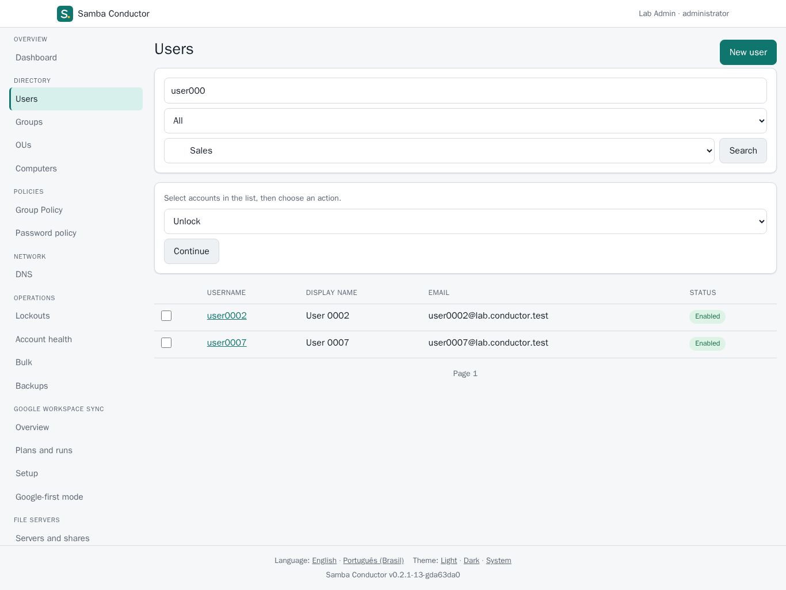
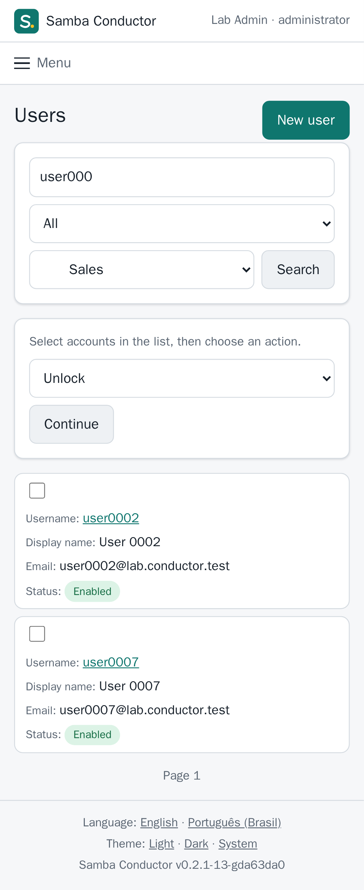
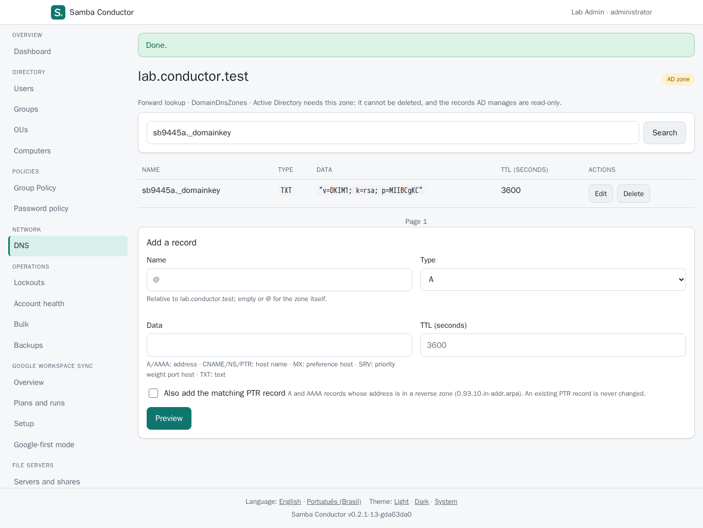
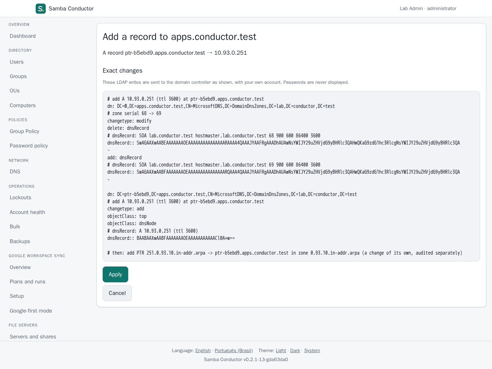
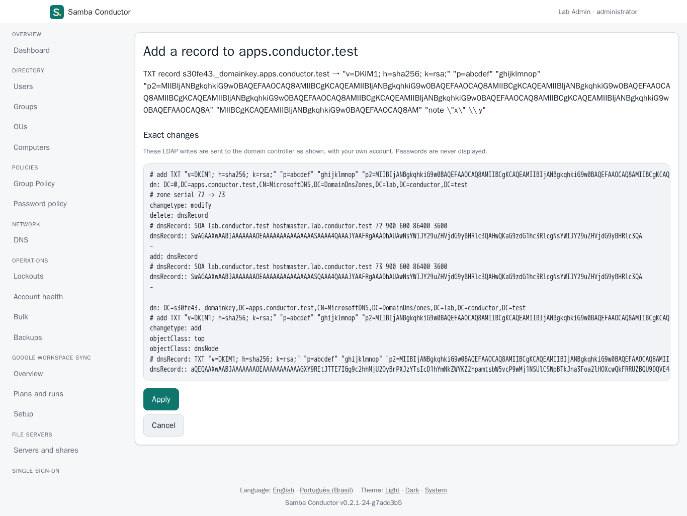
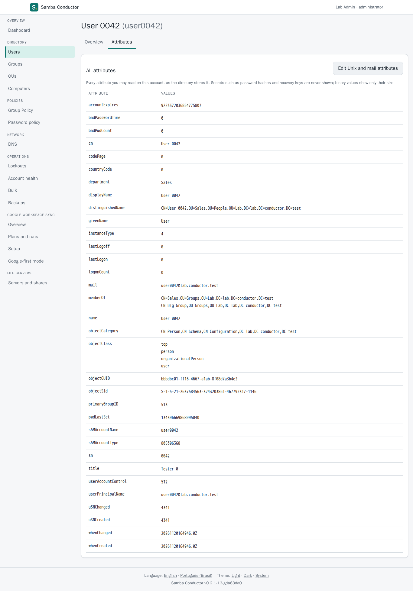
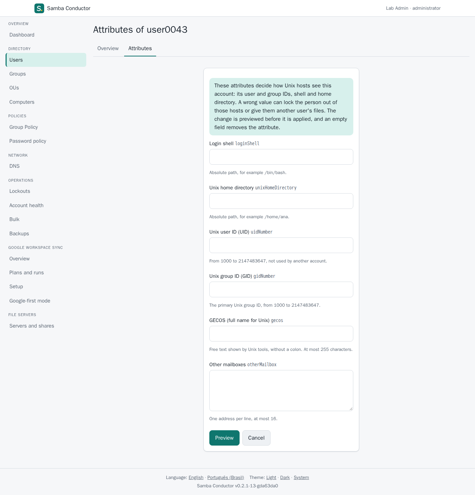
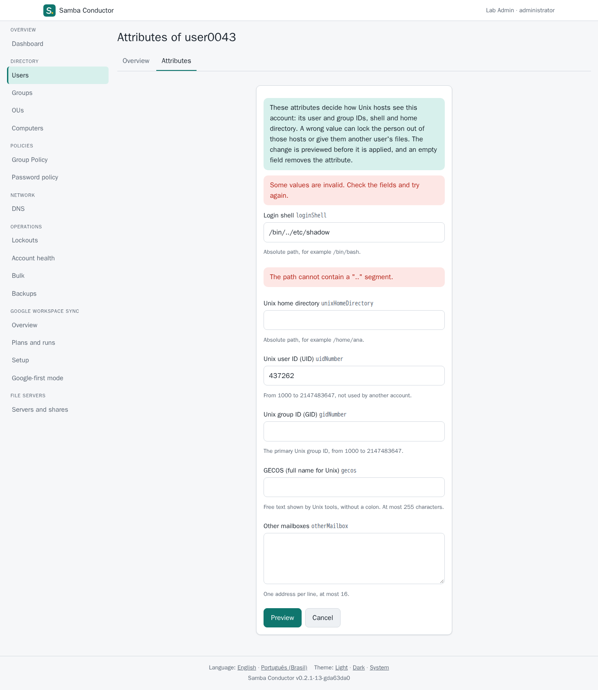
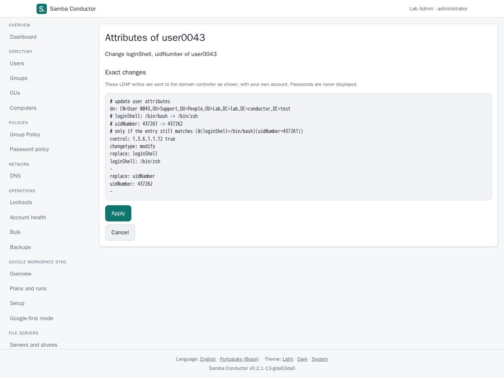
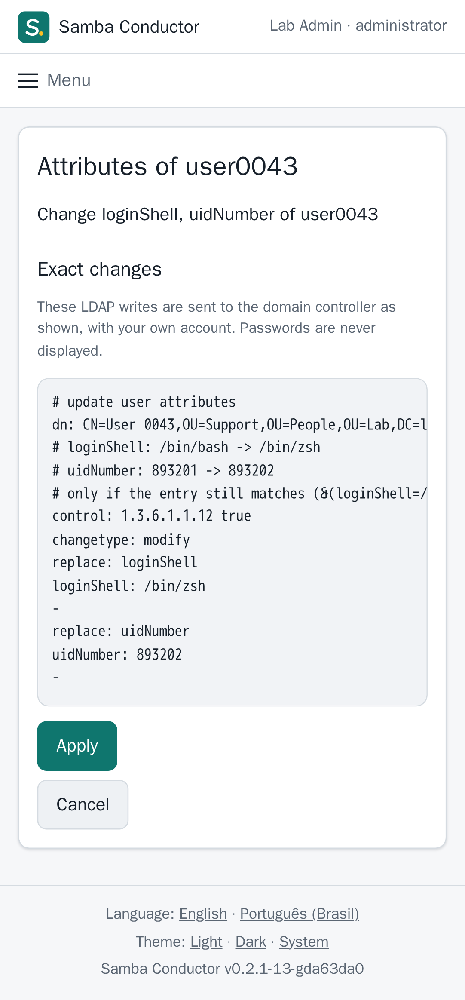

# Container filter, reverse DNS and the Attributes tab

Three additions to the administration pages:

- the Users, Groups and Computers lists can be limited to one container
  (an OU or a built-in container such as `CN=Users`);
- the DNS pages leave the names AD does not own to the administrator, a
  new A or AAAA record can bring its PTR record, and TXT records are typed
  one string per line;
- a user's Attributes tab shows every attribute the signed-in user may
  read on the account, and an opt-in editor changes a short list of Unix
  and mail attributes.

The last section is the lab run that exercised them.

## Container filter on the lists

The Users, Groups and Computers lists have a "Container" picker next to
the search box. It offers "Entire domain" (the default), every OU the
signed-in user can read, and the built-in container of the list
(`CN=Users` on Users and Groups, `CN=Computers` on Computers), drawn as an
indented tree. Choosing one limits the list to that container and
everything below it. The text filter, the status filter of the Users list
and the pager keep the choice.



The choice is part of the address (`?ou=` followed by the container's
DN), so a filtered list can be bookmarked or sent to a colleague. The
picker works the same on a phone:



Who can use it: everyone who can open the list (administrators, helpdesk
and auditors). It only narrows what the list shows.

What a sysadmin should know:

- The searches still run with the signed-in user's own identity. The
  picker cannot show an object the domain controller would not return to
  that user, and it lists only the OUs that user can read.
- The value of `?ou=` is used only as the base of the search, never inside
  an LDAP filter. It must parse as a DN below the domain and match one of
  the containers just read from the directory. Anything else (a typo, a
  DN of another domain, a filter expression) shows the entire domain with
  a short notice instead of an error.

## DNS: names AD owns and PTR records

### Which records are read-only

The AD zones (the domain zone and `_msdcs`) are shared between AD and the
administrator. conductor keeps read-only only the records a domain
controller registers and depends on:

- the `_ldap`, `_kerberos`, `_kpasswd` and `_gc` locators under `_tcp` and
  `_udp`, and everything under `_msdcs`, `_sites`, `DomainDnsZones` and
  `ForestDnsZones`;
- the addresses of the domain apex and the host records of the domain
  controllers;
- the zone's SOA and NS records at the apex.

These rows carry an "AD-managed" badge and have no edit or delete
control, and a request that tries to change them anyway is refused by
the server. Every other name is the administrator's, including names with
a leading underscore such as `_dmarc`, `selector._domainkey`,
`_acme-challenge`, `_mta-sts` or an application's `_sip._tcp` record, so
DKIM, DMARC and ACME records can be kept in the domain zone.



### Adding the PTR record with an address

When the directory holds a reverse zone, the "Add record" form of a
forward zone offers "Also add the matching PTR record" for A and AAAA
records. It is unchecked by default. When checked:

- the most specific reverse zone that covers the address is used, and the
  PTR record points to the full name of the new record;
- the preview shows the address record and, below it, the PTR record that
  will follow;
- the PTR record is added after the address record, with the same user's
  connection, as a separate change with its own audit entry;
- an existing PTR record with the same target counts as done; one with
  another target is never changed, and the page says so;
- if adding the PTR record fails, the address record stays and the page
  shows why.



Who can use it: administrators (the DNS pages are read-only for auditors
and not shown to helpdesk). Nothing needs to be enabled; the option shows
when a reverse zone covers the address.

### TXT records, one string per line

A TXT record holds one or more character-strings of at most 255 bytes
each; a DKIM key is usually split over several. When TXT is selected in
the "Add record" form, the one-line Data field is replaced by a
multi-line "TXT data" field (the stylesheet swaps them, no script runs),
and the edit page of a TXT record shows the same kind of field. The text
is read as follows:

- each non-empty line becomes one string; blank lines and the spaces at
  the start and end of a line are ignored;
- a line longer than 255 bytes is split into strings of 255 bytes,
  never inside a UTF-8 character;
- a line that starts with a double quote is read as one or more quoted
  strings (`"a" "b"`, with `\"` and `\\` escapes), each of which must fit
  in 255 bytes; any other line is taken literally, quotes and
  backslashes included;
- the record holds at most 4000 bytes in all, counting one length byte
  per string.

For example, the three lines

```
v=DKIM1; h=sha256; k=rsa;
p=abcdef
ghijklmnop
```

are stored as `"v=DKIM1; h=sha256; k=rsa;" "p=abcdef" "ghijklmnop"`. The
preview shows the record in this quoted form, exactly as it will be
stored, so the split of a long line can be checked before it is applied.
The edit page shows the strings one per line again (quoted only when a
string would not read back the same way, for example one that starts
with a double quote or has spaces at its ends), and saving it unchanged
changes nothing. One-line input keeps working as before: quoted strings
on one line, or one value split every 255 bytes.



## The Attributes tab and the attribute editor

### The Attributes tab

A user's page has an Attributes tab next to the overview. It lists every
attribute the signed-in user may read on the account, read with that
user's own Kerberos ticket, sorted by name, long values wrapped (no
sideways scrolling on a phone).



Who can see it: administrators and auditors. Helpdesk accounts do not get
the tab, and its address answers 403 for them.

What is never shown, even when the domain controller returns it: password
hashes and histories, `supplementalCredentials`, gMSA, LAPS, BitLocker and
TPM data, key credentials, `nTSecurityDescriptor` and trust secrets. Such a
row shows only a "Hidden (secret)" badge. Binary values, and values that are not
valid UTF-8 or hold control characters, show only their size, and at most 50 values per
attribute and 1024 bytes per value are shown.

### The restricted attribute editor (opt-in)

The editor is off by default. To turn it on, set in
`/etc/conductor/conductor.toml`:

```toml
[ui]
advanced_attribute_edit = true
```

and restart conductor (`systemctl restart conductor`). While it is off the
editor's pages answer 404 and the Attributes tab stays read-only.

With it on, administrators get an "Edit Unix and mail attributes" link on
the Attributes tab. The editor changes these attributes only (an empty
field removes the attribute):

| Attribute | Accepted values |
|---|---|
| `loginShell`, `unixHomeDirectory` | an absolute path of letters, digits and `/ _ . + -`, no `..` segment, at most 255 bytes |
| `uidNumber`, `gidNumber` | a decimal number from 1000 to 2147483647 |
| `gecos` | printable text without `:`, at most 255 bytes |
| `otherMailbox` | plain addresses (`local@domain`), one per line, at most 16 |



Every value is checked on the server before anything is proposed, and a
refused value is reported next to its field:



A valid change goes through the usual preview, which shows the old and
new value of each attribute and the condition under which it is written:



The same preview on a phone:



What a sysadmin should know:

- Only the names above are read from the form; no other attribute can be
  written through the editor, whatever is posted.
- A `uidNumber` already used by another account is refused. The check is
  made against the directory when the change is previewed; tools other
  than conductor are not stopped from assigning the same number later.
- The change is conditional on the values read for the preview: if
  someone changed the account in the meantime, it fails instead of
  overwriting their change.
- With the Google-first mode on, attributes Google owns for a managed
  account are refused.
- Changes to protected accounts (members of the privileged groups and of
  conductor's role groups) always ask for the password and a second
  factor again; other accounts do when the second factor is more than five
  minutes old.
- Every change is written to the audit log as `user.attributes_update`
  with the old and new values.
- The write uses the administrator's own identity, so AD's permissions
  still apply.

## Lab run

Transcript of `e2e/run-lab.sh` against the lab
([testing.md](https://github.com/openbasalt/samba-conductor-docs/blob/main/testing.md)),
run on 2026-11-20 from commit `da63da0` (conductor `v0.2.1-13-gda63da0`,
built with Go 1.27.4 together with the current main branch of the other
components). No secrets appear: passwords reach the Playwright container
only through a temporary 0600 env file on the lab host, and screenshots
mask TOTP secrets, QR codes and recovery codes.

What happens:

1. The lab snapshots are rebuilt from the seeded domain with this build,
   in order: backups (with one backup and one passed restore drill), the
   Google Workspace sync section with the fake Directory API, the file
   server fs1 joined with conductor-files, conductor-idp, and finally
   conductor-provisioner with the mail sink. The last snapshot holds dc1,
   dc2 and fs1.
2. Per project (`desktop` 1366x900, `mobile` Pixel 7): the lab is reset to
   that snapshot, the whole suite runs in
   `mcr.microsoft.com/playwright:v1.65.0-noble`, then the audit chains of
   conductor, conductor-idp and conductor-files are verified.
3. The attributes spec runs again on each project with
   `[ui] advanced_attribute_edit = true` set on dc1 (and conductor
   restarted) after a fresh reset, so the editor is exercised too. With the
   option off, the same spec checks that the editor's page answers 404.

| Spec | Covers |
|---|---|
| `08-dns` | DKIM, DMARC and SIP records added, edited and deleted in the AD zone, the AD locators still read-only; an A record with its PTR record (unchecked by default, the preview names the reverse zone, the PTR record points to the new name); a second name on the same address leaves the existing PTR record alone and says so; no PTR option in a reverse zone |
| `21-attributes` | administrator: the Attributes tab with the account's attributes and no secret; helpdesk: no tab, 403 on its address and on the editor's; with the option on: `loginShell` and `uidNumber` changed through the preview, old and new values in the preview and the audit log, refusals of `uidNumber` 0, a relative shell, a path with `..` and a UID already in use, all before any preview |
| `22-ou-filter` | Users of a department OU and of its parent OU, the choice kept with the text filter and in the address; a DN of another domain and a filter expression fall back to the entire domain with the notice; Groups of `CN=Users` and of the groups' OU; Computers of the workstations' OU without the domain controllers |

Results, default configuration (77 tests per project):

| Project | Passed | Failed | Skipped | Did not run |
|---|---|---|---|---|
| desktop | 70 | 1 | 4 | 2 |
| mobile | 70 | 1 | 4 | 2 |

- Skipped by design: the missed-schedule backup check (it needs a lab
  prepared an hour earlier) and the three Google-first mode tests (they
  need a real Google Workspace test domain).
- The failure was in the e-mail reset spec (`18-passwords`, "revoked and
  unknown links show the same neutral page"), and the two tests after it
  in the same serial group did not run. It was a race in the test: it
  counted the reset messages after posting the form, but the reset is
  mailed in the background, so it went on with the previous link and
  opened the user's page about three seconds before the new link existed.
  The test now counts first. With the fix, the whole spec (8 tests) passes
  on desktop and mobile on a fresh reset.
- With `advanced_attribute_edit = true`: 4 of 4 passed on desktop and on
  mobile.
- The audit chains verified after every run.

Screenshots: `docs/screenshots/desktop/{08-dns-dkim,08-dns-ptr-preview,21-attributes*,22-ou-users}.png`
and `docs/screenshots/mobile/{21-attributes-preview,22-ou-users}.png`.

### Lab run of the TXT field

Run on 2026-11-24 with conductor `v0.2.1-24-g7adc3b5` (the ad library at
the commit go.mod pins), the conductor-p4b snapshot rebuilt with this
build, and the suite in `mcr.microsoft.com/playwright:v1.65.1-noble`.

| Spec | Covers |
|---|---|
| `23-dns-txt` | the TXT field replaces the one-line field only while TXT is selected; six lines (one of 300 bytes, one with quotes and a backslash) and trailing blank lines become six strings, the long line split at 255, shown quoted in the summary and the exact changes; the page does not scroll sideways; the edit page shows the strings one per line; saving unchanged says nothing would change; a changed line shows old and new; the DNS service of dc1 and of dc2 (after replication) answers the same strings |
| `08-dns` | unchanged checks, with TXT data typed in the new field |

Results (78 tests per project):

| Project | Passed | Failed | Skipped |
|---|---|---|---|
| desktop | 67 | 0 | 11 |
| mobile | 67 | 0 | 11 |

The skipped tests need the conductor-gfa snapshot (the e-mail specs), a
lab prepared an hour earlier (the missed-schedule check) or a real
Google Workspace domain. The audit chains verified after both runs.
`samba-tool dns query` on dc1 and dc2 lists the record with the same six
strings, and a record of 4000 bytes (15 strings of 255 bytes and one of
159) is stored by Samba, replicated and answered by both DCs.

Screenshot: `docs/screenshots/desktop/23-dns-txt-preview.png`.
